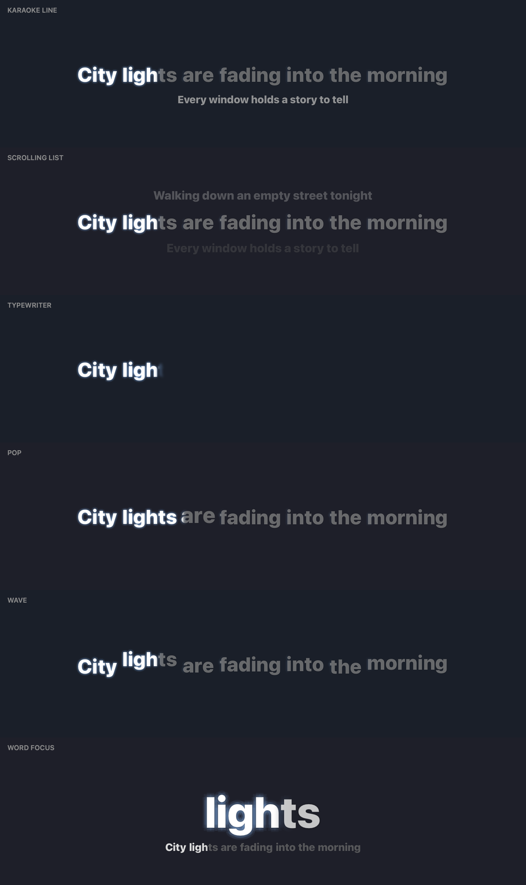
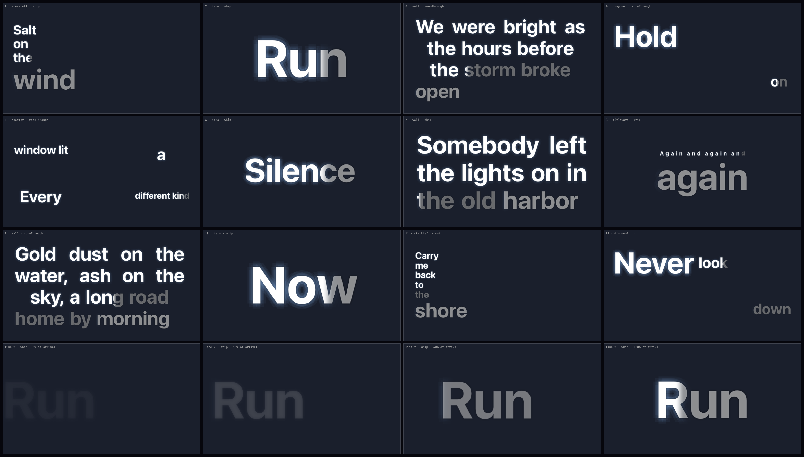
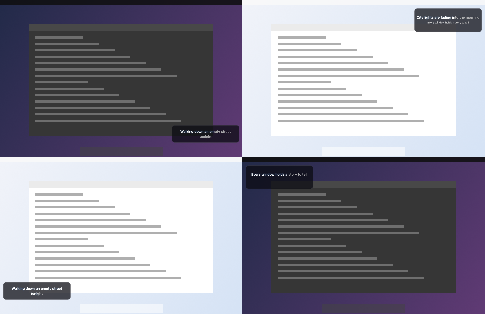
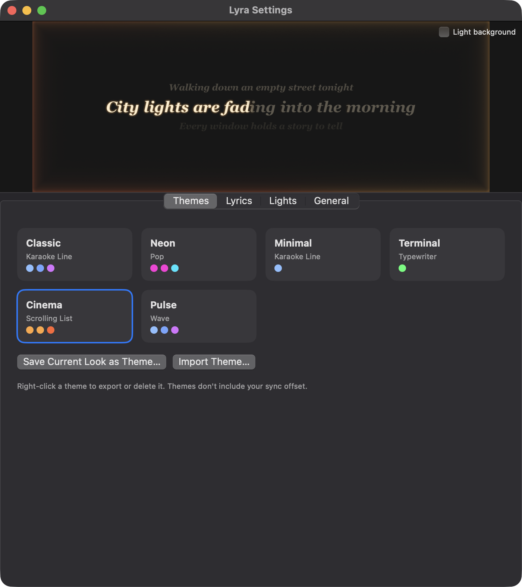
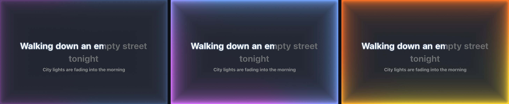
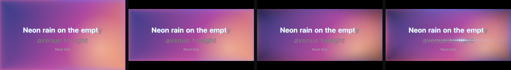

# Lyra

**Free, open-source, word-by-word synced lyrics and beat-reactive edge lighting for macOS.**

Lyra shows what is playing in Spotify or Apple Music with each word lighting up as it is sung, over your
desktop, over full-screen apps, in a small corner card, or in a standalone player window with your own
picture or video behind it. A glowing edge pulses with the music and takes its colors from the cover art.
It can even restyle itself to match each song.

## Gallery

| | |
|---|---|
|  |  |
|  |  |
|  |  |

These are rendered by Lyra's own `--render-*` flags (see [Building](Docs/BUILDING.md)).

> Requires macOS 14 or later on Apple silicon. No account, no subscription, no analytics. MIT licensed.

## Features

| | |
|---|---|
| **Desktop overlay** | Lyrics across the whole display on every screen, click-through, also drawn over other apps' full-screen Spaces. |
| **Corner mode** | A small caption card in the corner of your choice. Toggle from anywhere with **⌃⌥L**. |
| **Player window** | Lyrics over an uploaded picture, looping video or built-in gradient. Glowing border colored from the background, scrubbable progress bar, native full screen, optional keep-awake. |
| **Match the music** | Optional. Picks a theme from the song's genre, cover art and sound, and can switch once the audio has been heard. |
| **Styles** | Karaoke Line, Scrolling List, Typewriter, Pop, Wave, Word Focus and Cinematic (every line composed as a film shot). |
| **Film look** | Letterbox, vignette, grain and a beat-driven light streak in the player window. |
| **Fonts** | Curated macOS fonts, 23 original Lyra fonts (8 generated, 15 hand-drawn), and your own `.ttf`/`.otf`/`.ttc`/`.otc` files with live previews. |
| **Themes** | About 50 built-in looks, each with its own typeface, style, colors, lighting and animation. Save, export and import your own. |
| **Edge lighting** | Rim glow reacting to beats and bass, colored from the album art or your own colors. |
| **Animations** | 12 entrance and 5 exit animations. |

## Install

**Download:** get `Lyra-<version>.dmg` from the Releases page, open it and drag Lyra to Applications.
Releases are not notarized yet, so the first launch needs **right-click → Open** (or System Settings →
Privacy & Security → **Open Anyway**). If macOS says the app is damaged, run
`xattr -dr com.apple.quarantine /Applications/Lyra.app`.

**Or build it yourself** (takes a minute; Scripts/make-dmg.sh makes the dmg):

```bash
git clone https://github.com/JoeArmageddon/lyraoverlay.git && cd lyraoverlay
Scripts/make-app.sh
open dist/Lyra.app
```

You need Xcode (or the Command Line Tools) with a Swift 6 toolchain. Details, including keeping macOS
permissions across rebuilds, are in [Docs/BUILDING.md](Docs/BUILDING.md).

## First run

1. Start Spotify or Music and play a song. Allow **Automation** when macOS asks, so Lyra can read what is playing.
2. Lyrics appear on your desktop. The menu bar icon (♪) shows the track, lyrics status and audio status.
3. For beat-reactive lights, allow **System Audio Recording** when asked. Lyra works without it; the lights then breathe gently.
4. Open **Settings** (⌘,) to pick a theme, style, font and lighting.

Everything is explained in the [User Guide](Docs/USER_GUIDE.md).

## Documentation

| Document | For |
|---|---|
| [User Guide](Docs/USER_GUIDE.md) | Every feature and setting |
| [Troubleshooting](Docs/TROUBLESHOOTING.md) | Nothing showing, permission loops, sync, fullscreen |
| [Privacy](Docs/PRIVACY.md) | What Lyra reads, stores and sends |
| [Building](Docs/BUILDING.md) | Build, run, sign, test |
| [Architecture](Docs/ARCHITECTURE.md) | How the code is organized |
| [Fonts](Fonts/README.md) and [Font prompts](Docs/FontPrompts.md) | Adding and designing fonts |
| [Releasing](Docs/RELEASING.md) | Maintainers: signing and publishing |
| [Contributing](CONTRIBUTING.md), [Security](SECURITY.md), [Code of Conduct](CODE_OF_CONDUCT.md) | Community |

## Known limits

- **No lock-screen display.** Ordinary app windows are not drawn over the macOS lock screen. We tried several private-API approaches on macOS 27 and none worked (see [Spikes](Spikes/README.md)).
- Spotify and Apple Music only.
- Some songs have no synced lyrics on LRCLIB; the lights still work.
- Word timing is estimated by syllable when the source only times whole lines.
- Match the music's audio thresholds are heuristics and still being tuned.

## Credits and license

Lyrics come from [LRCLIB](https://lrclib.net). Lyric text belongs to its rightsholders; Lyra only caches it
locally and never redistributes it. Code is MIT ([LICENSE](LICENSE)); fonts are SIL OFL 1.1
([Fonts/LICENSE.txt](Fonts/LICENSE.txt)). See [THIRD_PARTY_NOTICES.md](THIRD_PARTY_NOTICES.md).
Lyra is an independent project, not affiliated with Spotify, Apple, Verci or Lumn.
